# Tiny Dent

**A procedural sandbox where you reshape small planets, by hand or through autonomous robots, and watch the residents decide whether they like what you did.**

Final project for DESIGN 4197/6197, Procedural World Building (Cornell, Fall 2026).

> “We’re here to put a dent in the universe.” —— Steve Jobs

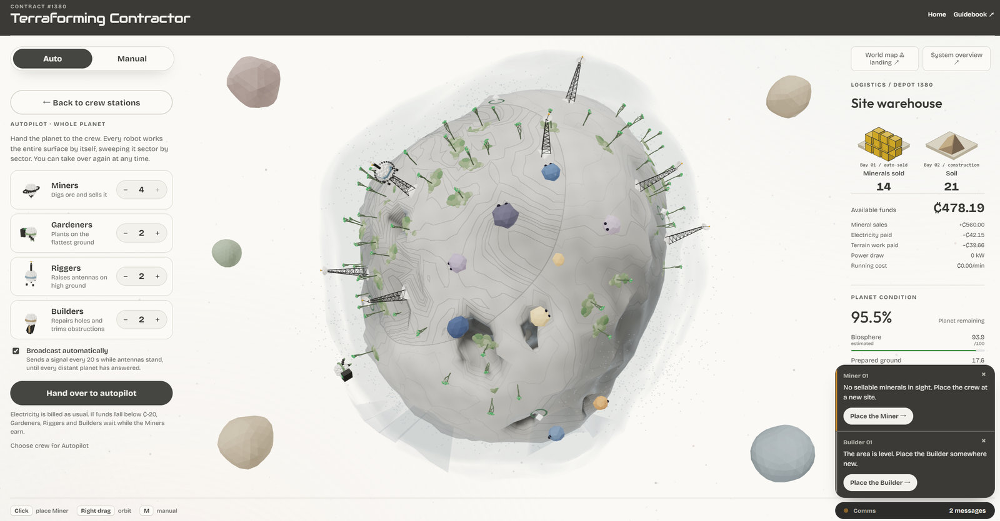

**Play and read:** the project site is served at `/`, the game at `/game/`, and the course [guidebook](worldbuilding-guidebook/) at `/guidebook/`. To run it locally, see [Run it locally](#run-it-locally).

## The idea

Every planet starts from a seed: a shape, a mineral budget, a species of residents. You place robots, size their work areas, and let them carve, plant, and build. The planet changes; the residents react. They shelter underground, peek out, tremble near robot work, and move toward quieter ground. They “vote with their feet,” so the consequences of your work are visible without the game declaring one ideal outcome.

```text
planet starting conditions → player choices and robot work → environmental change
        → resident responses → different planetary outcomes
```

You may chase resources, grow flourishing habitats, or pursue strange planetary forms. Planets that answer your broadcasts become new, persistent sites to visit, so each run grows into a small system of different worlds.

## References

The look and the premise come from two places: a game that proved planets can be soft, editable toys, and a book that proved a planet can be small enough to care for.

### Astroneer

*Astroneer* (System Era Softworks, 2016) is the closest relative. Its planets are volumetric: a terrain tool digs, raises, and flattens a density field, and the chunked surface re-meshes under your hands. Its colour language (saturated, faceted, friendly) shows that an editable planet can still read as a toy. We borrow the premise of small, distinct, fully editable worlds, and the idea of travelling between them.

<p>
  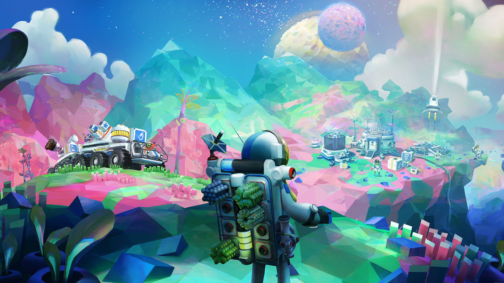
  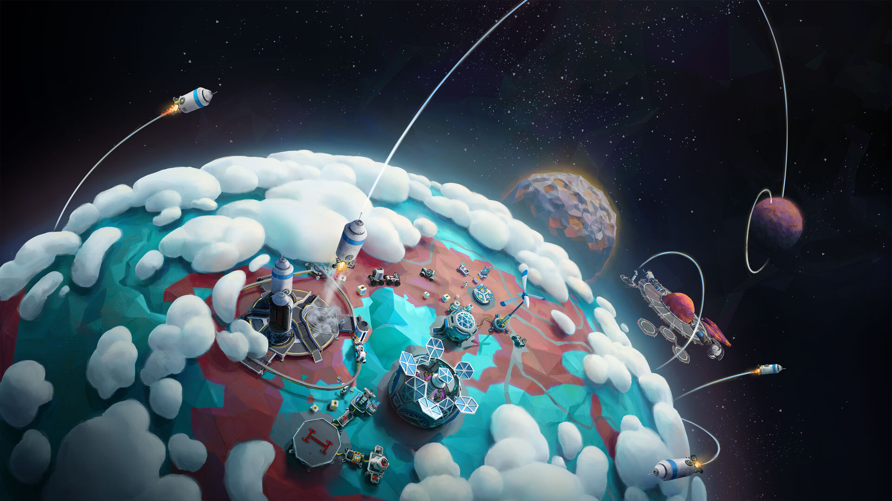
</p>

*Images: Astroneer promotional art, © System Era Softworks. Used for reference only.*

Where we diverge: in Astroneer the player does the digging. In #1380 the player’s main verb is *delegating*. Robots follow visible rules, and the interesting part is the planet’s response.

### *The Little Prince*

Saint-Exupéry’s prince lives on a planet small enough to tend every day: weeding baobabs, sweeping volcanoes, watching one flower. That scale is the emotional target. A planet should be small enough that one change is visible from space and that its inhabitants can be known individually.

<p>
  
  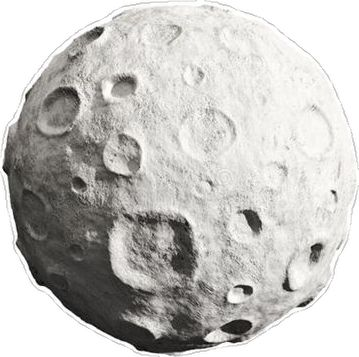
</p>

*Left: The Little Prince, Starcatcher edition, property of Succession de Antoine de Saint-Exupéry (POMASE), licensed through LPP612 and Medialink, 2024. Right: stock image of a cratered rock planet. Both used for reference only.*

The planet in the game is a pale, cratered body in the same spirit: a single rock you can hold in your head.

### Rock creatures and stones

The residents are small rock creatures, and the planet’s surface language is flat-shaded stone. A character sheet of mossy, crystalline, and sleepy rock beings set the tone for their personalities and silhouettes. A sheet of flat-shaded stones set the faceted look of the terrain and boulders.

<p>
  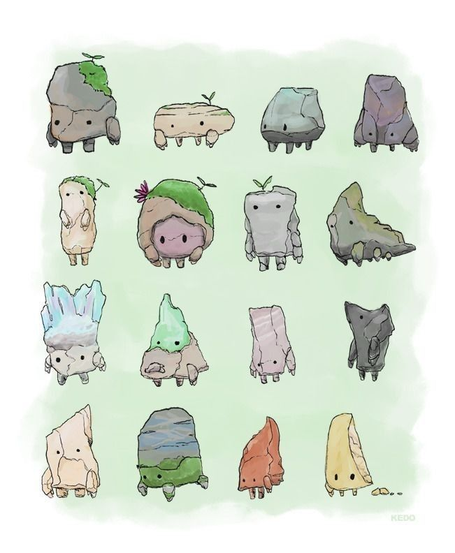
  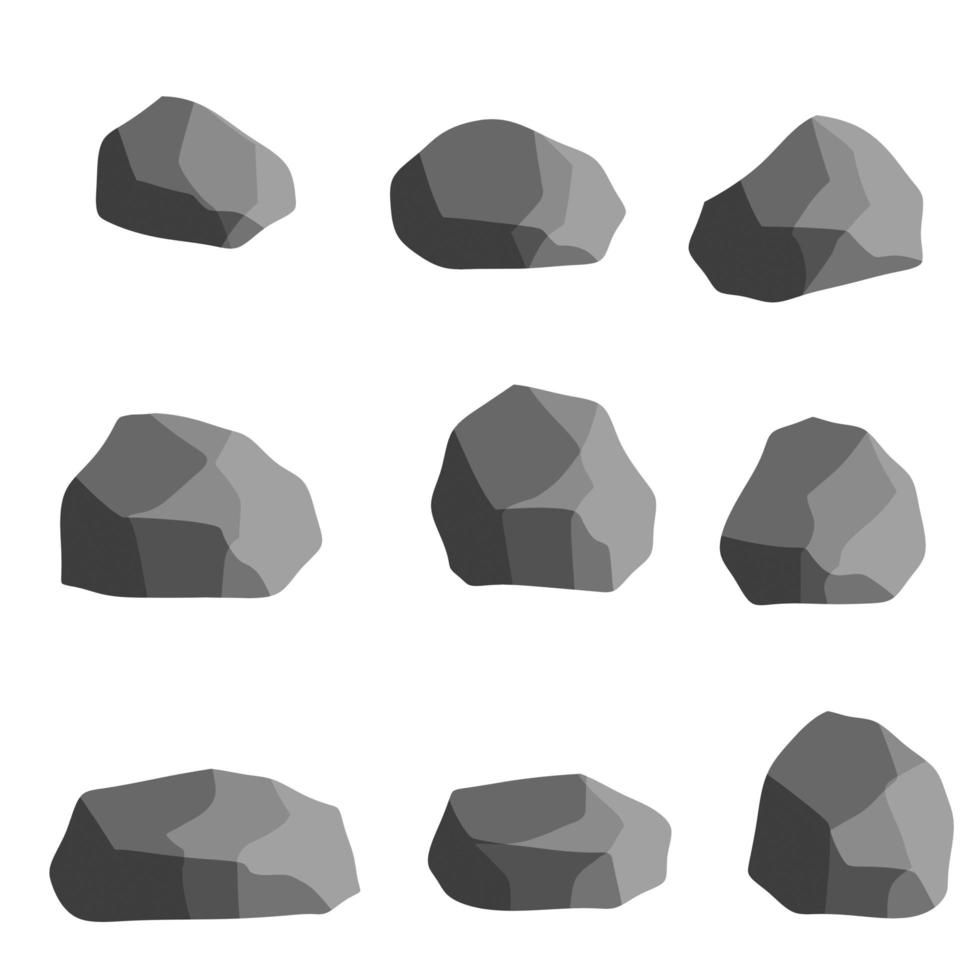
</p>

*Left: rock-creature character sheet signed “KEDO.” Right: stock illustration of stones. Both used for reference only.*

These references fed the component board and the resident design board shown below.

## How it plays

- **Auto and Autopilot.** Place a Miner, Gardener, Builder, or Rigger, size its spherical work area, and it works by itself. Autopilot hands the whole planet to the crew, which sweeps the surface sector by sector.
- **Manual.** Dig, Add Terrain, Flatten, and a Detector that scans for Mineral, Life, and Memory signals. Manual mode pauses the simulation, so robots never dig unseen.
- **Economy.** Minerals sell on delivery, running robots draw billed electricity, manual edits cost credits, and a run ends in bankruptcy at −₡50.
- **Signal planets.** Once antennas stand, the player can broadcast. After the third broadcast, answering planets appear. Each is a persistent site with its own seed and shape, and the run’s funds are shared among them.
- **System overview.** A 3D view shows the home site and the answering planets together; clicking a world focuses it.
- **Residents.** One species per planet, nine procedurally generated body directions compared on a design board.

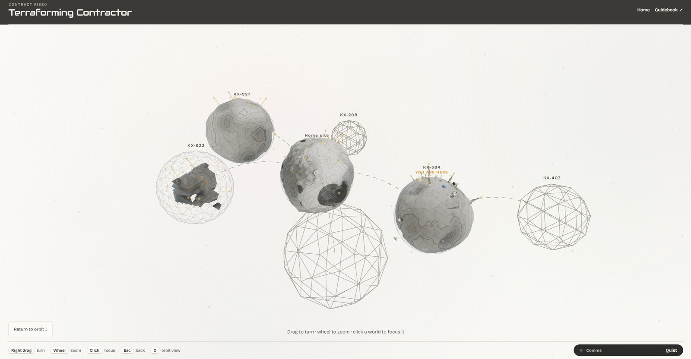

## How it is made

The planet is a **density field** with one sign rule (negative inside). A seeded sphere-plus-noise function builds it, edits add or subtract from it, and **chunked Marching Cubes** turns it into a mesh. Only chunks an edit touches are rebuilt, and a three-level distance-based LOD with seam snapping keeps far terrain cheap while the full-resolution field stays the source of truth.

Everything else is rules over that field:

| Part | What it does | Technique |
| --- | --- | --- |
| Planet | Seeded shape, mineral deposits, per-planet variation | density field, noise, seeded RNG |
| Terrain editing | Dig, add, flatten; affected chunks re-mesh | CSG on a density field, dirty-chunk remesh |
| Miner | Finds minerals, flies a hover shell, carves tunnels | path following, density subtraction |
| Gardener | Plants on flat ground, raises antennas on high ground, plants spread | distributions, slope filtering |
| Builder | Cuts high ground and fills low ground with mined soil | cut and fill |
| Residents | Shelter, peek, tremble, relocate | disturbance fields, walkable routes |
| Look | Voxel-orb robots, contour-line terrain, point-cloud atmosphere, one palette file | shaders, particles |

The techniques come from the course lessons in the [guidebook](worldbuilding-guidebook/): noise and erosion, voxels, shaders, distributions, paths, particles, and branching systems. The game does not share code with the guidebook; it ports the ideas.

## System architecture · 系统层与技术

系统分为 **Planet Scale 的 7 层**与 **System Scale 的 3 层**。这是一种职责划分，不是每帧的执行顺序。以下按当前源码核对：1–9 层已有实现，其中材质、社会关系、地面交通、本地物流采用简化模型；第 10 层已实现经济核算，完整全局经济仍属后续方向。首页的 **System atlas** 提供对应的双尺度可展开系统图。

### Planet Scale — 7 layers

| 层级 | 系统与当前实现 | 技术 | 源码入口 |
| --- | --- | --- | --- |
| 1. Terrain & Geometry / 地形与几何 | 种子噪声生成密度场，挖掘、填补、整平后仅重建受影响区块；距离 LOD 控制网格细节。 | Noise · Density Field · Marching Cubes | [world/planet.ts](tiny-dent/src/world/planet.ts) · [world/voxels/](tiny-dent/src/world/voxels/) |
| 2. Materials & Resources / 材质与资源 | 种子决定原生材质与矿藏；各星球独立库存，进口材料可铺成局部栖息地。当前是原生表面 + 局部铺层，并非完整三维 Material Field。 | Seeded Distribution · Surface Patches | [content/materials.ts](tiny-dent/src/content/materials.ts) · [systems/inventory.ts](tiny-dent/src/systems/inventory.ts) · [systems/patches.ts](tiny-dent/src/systems/patches.ts) |
| 3. Vegetation & Infrastructure / 植被与基础设施 | 采样与坡度筛选决定种植位置，生长规则驱动扩散；天线支持发现，太空港作为航线端点。 | Spatial Sampling · Growth Rules | [systems/placer.ts](tiny-dent/src/systems/placer.ts) · [systems/structures.ts](tiny-dent/src/systems/structures.ts) · [systems/logistics.ts](tiny-dent/src/systems/logistics.ts) |
| 4. Residents & Habitat / 居民与栖息地 | 物种偏好结合材料、水域、干扰、植被和同类邻居计算适宜度；居民以舒适度、归属感及状态机响应环境。 | Agent-Based Modeling · Habitat Suitability | [systems/residents.ts](tiny-dent/src/systems/residents.ts) · [systems/habitat.ts](tiny-dent/src/systems/habitat.ts) · [content/species.ts](tiny-dent/src/content/species.ts) |
| 5. Colonies & Social Graph / 聚落与社会关系 | 同类居民按住处距离连成连通分量，派生聚落成员与中心；尚无持久的人际关系图或复杂社会行为。 | Neighborhood Search · Connected Components | [migration.ts](tiny-dent/src/systems/migration.ts) |
| 6. Movement & Roads / 移动与道路 | 有搜索预算的 A* 规划地表路径；通行热度累积与衰减，Builder 消耗材料铺路。热度来自服务点间模拟行程，非所有居民的真实步迹；飞行机器人不贡献热度。 | A* · Traffic Heatmap · Desire Paths | [graph/surfaceGraph.ts](tiny-dent/src/graph/surfaceGraph.ts) · [systems/traffic.ts](tiny-dent/src/systems/traffic.ts) |
| 7. Local Logistics / 本地物流 | 采挖入库，Builder 按需求与优先级分配工作，建造铺层、平台、道路或修整地形并扣除材料；本地库存共享，未逐件模拟搬运。 | Task Allocation · Resource Accounting | [systems/builder.ts](tiny-dent/src/systems/builder.ts) · [systems/inventory.ts](tiny-dent/src/systems/inventory.ts) |

### System Scale — 3 layers

| 层级 | 系统与当前实现 | 技术 | 源码入口 |
| --- | --- | --- | --- |
| 8. Planet Network / 星球网络 | 种子生成星球布局，已访问星球作为节点；玩家连接两端太空港，距离决定航线造价与行程时间。 | Graph Theory · Procedural Layout | [systems/system.ts](tiny-dent/src/systems/system.ts) · [graph/graphCore.ts](tiny-dent/src/graph/graphCore.ts) |
| 9. Interplanetary Transport & Migration / 星际运输与移民 | Dijkstra 按旅行时间寻找最短航线；货物和居民经历在途、到达或退回，护照保留身份及旅程，移民经历探索、定居、思乡与返乡。 | Dijkstra · State Machine | [systems/logistics.ts](tiny-dent/src/systems/logistics.ts) · [systems/creatures.ts](tiny-dent/src/systems/creatures.ts) · [systems/migration.ts](tiny-dent/src/systems/migration.ts) |
| 10. Economy & Global Simulation / 经济与全局模拟 | 已实现共享资金、矿物销售、电费、编辑费、建港建线成本、运费和跨星球库存流转；尚无供需动态定价。仅活动星球执行本地模拟，非活动星球保留快照并接收运输结算。 | Stock–Flow Accounting · Rule-Based Simulation | [systems/economy.ts](tiny-dent/src/systems/economy.ts) · [systems/simulation.ts](tiny-dent/src/systems/simulation.ts) · [state/planets.ts](tiny-dent/src/state/planets.ts) |

### 跨层反馈

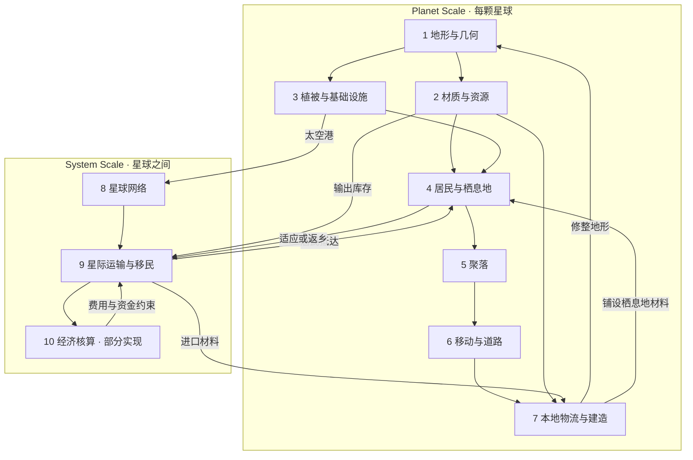

例如：移民不适应当地材料 → 提出材料需求 → 从其他星球运入材料 → Builder 扣除库存铺设栖息地 → 舒适度与归属感重新计算 → 居民定居或请求返乡。另一条反馈是通行热度 → 道路建造 → 更低通行成本 → 后续路径选择改变。

**运行边界：** [simulation.ts](tiny-dent/src/systems/simulation.ts) 使用固定步长，按顺序推进自动控制、电费、机器人、地表变化、植被、居民、迁移、交通、水域和星际物流。活动星球执行本地模拟；其他星球保留快照，运输到达可以更新其库存与居民。当前没有所有星球持续并行演化的全局模拟，也没有市场供需驱动的动态价格。

**技术栈：** TypeScript、React 19、Three.js / React Three Fiber、Zustand、Vite；生成与规则模拟主要位于 `world/`、`graph/`、`systems/`，状态位于 `state/`，渲染位于 `render/` 与 `views/`。首页使用 HTML / CSS 和共享游戏模型的 Three.js 场景。

### Design decisions

The look was chosen before any robot was built. A component board compared visual options for every on-planet element over five rounds, each option a 3D model at game scale. The chosen set uses voxel-orb robots that differ by silhouette, contour-line terrain shaded by height and slope, and a point-cloud atmosphere.

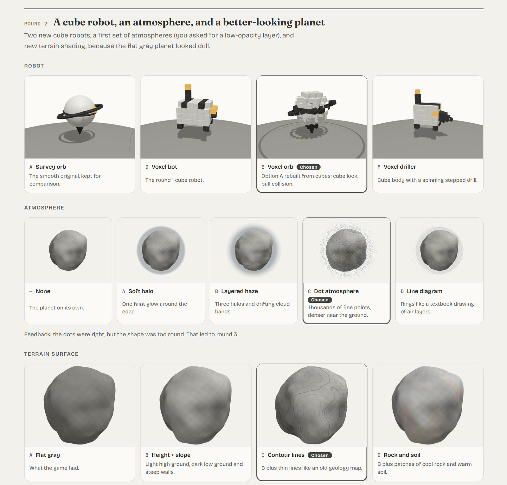

The residents followed the same method: nine body directions generated procedurally, then one species per planet.

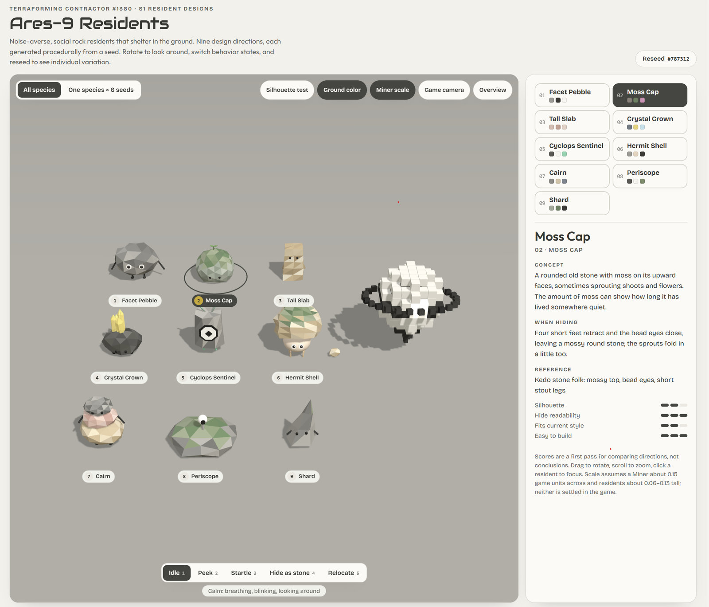

The full record is in the game docs:

- [Design](tiny-dent/docs/design.md): what the game is and why
- [Specification](tiny-dent/docs/spec.md) and [procedural system](tiny-dent/docs/procedural-system.md)
- [Decisions](tiny-dent/docs/decisions.md): numbered and dated
- [Roadmap](tiny-dent/docs/roadmap.md): what is built and what is not
- [Tuning](tiny-dent/docs/tuning.md) and [content](tiny-dent/docs/content.md)

## Current state

Implemented: manual terrain editing, four robot roles, Autopilot, site accounting, surface exploration, persistent signal planets, per-planet material inventories, habitat preferences, derived colonies, surface pathfinding and traffic-driven roads, Builder habitat patches, interplanetary cargo and passenger routes, and resident passports and migration states. See the ten-layer architecture above for implementation limits; the full global economy remains partial.

Not implemented, and marked as such in the [roadmap](tiny-dent/docs/roadmap.md): the end-of-run audit, planet classifications and the Silent / Heard / Erased endings (M5), cosmic ending visuals, and ending audio. Bankruptcy is the only way a run ends today.

## Development log

| Week | Game milestone |
| --- | --- |
| 6 (Sep 28) | `tiny-dent/` created: seeded sphere-plus-noise planet, chunked Marching Cubes, Dig / Add / Flatten, Detector |
| 6 | Component board decides the visual language |
| 7 (Oct 7) | Three-level distance-based terrain LOD |
| 7 | Teacher feedback (“what if the game played itself?”) turns the game toward robots; Miner, Gardener, Builder; Auto and Manual modes; economy; world map; broadcasts |
| 8 | Autopilot, Rigger, persistent signal planets, system overview, resident species |

### Week 6: the first prototype

The prototype uses a seeded sphere-plus-noise density field and extracts its surface with chunked Marching Cubes. Right-drag orbits the planet. Dig, Add Terrain, and Flatten edit the density field and rebuild affected chunks; Flatten supports both a local radial plane and a global horizontal plane. A remaining-volume estimate tracks terrain added or removed. The Detector scans a local patch and shows nearby terrain wireframe plus distance-faded Mineral, Life, and Memory signals, each with its own marker shape. Exposing a target’s centre collects it and updates the category count.

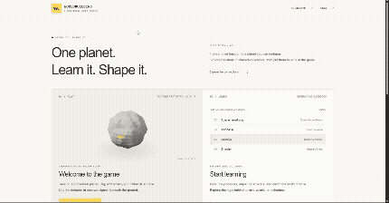

<p>
  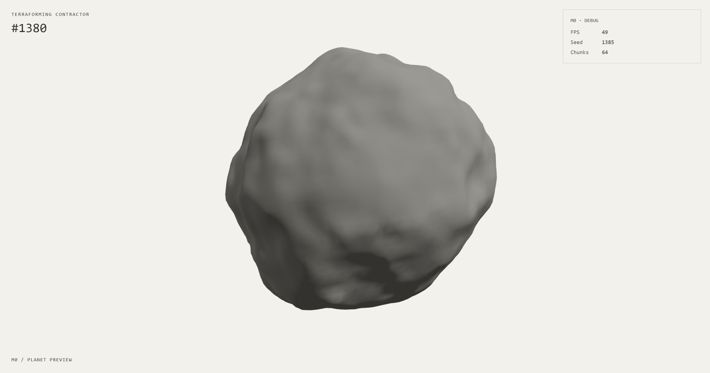
  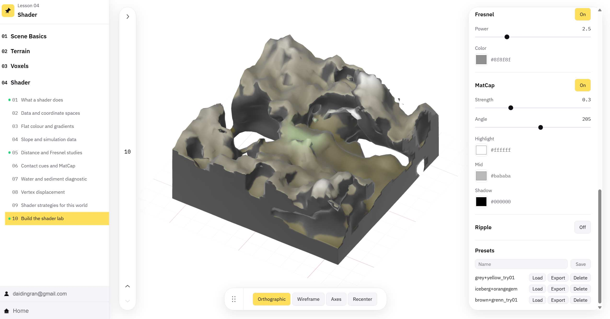
</p>

### Week 7: robots that terraform by rules

Teacher feedback asked what would happen if the game played itself, so the game shifted from manual digging to robots that change the planet by visible rules. The player places each robot and sizes its spherical work area; the robot then works on its own.

- **Miner** scans for nearby minerals, flies along a hover shell to the entry point above each one, and carves a radial tunnel one dig step at a time.
- **Gardener** samples ground points in its area. It plants on the flattest suitable ground and raises antennas on the highest. Mature plants spread to nearby ground, and digging removes any plant or antenna whose ground is lost.
- **Builder** measures the mean ground height of its area, cuts high ground down to that level, and fills low ground using soil the Miner has dug out.

The robots, terrain, and atmosphere use the look chosen on the component board. All colours come from one palette file, and a test fails if a model uses a colour outside it. Around the crew, the run gained a site economy and surface exploration with a 2D world map. Robot stop reasons and low-funds warnings arrive in a communicator with a button that leads to the fix.

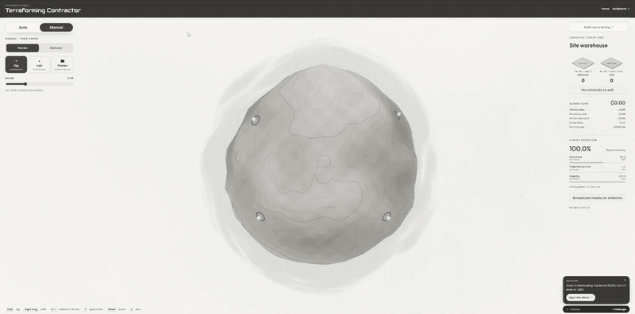

Key files: [planet generation](tiny-dent/src/world/planet.ts), [LOD](tiny-dent/src/world/lodChunks.js), [Miner](tiny-dent/src/systems/miner.ts), [Gardener](tiny-dent/src/systems/gardener.ts), [Builder](tiny-dent/src/systems/builder.ts), [decisions D-022 to D-033](tiny-dent/docs/decisions.md).

### Week 8: autopilot, signal planets, and residents

Autopilot hands the whole planet to the crew: Miners, Gardeners, Builders, and the new Rigger, which takes over antenna building, each sweep the surface sector by sector. Minerals now sell automatically on delivery, and manual terrain edits cost credits. Planets that answer a broadcast become persistent sites with their own seeds and shapes. Residents are small rock creatures that shelter underground, peek out, and tremble near robot work.

Key files: [game systems](tiny-dent/src/systems/), [decisions](tiny-dent/docs/decisions.md).

## Course work behind the game

The [guidebook](worldbuilding-guidebook/) is where each technique was learned and tested before it reached the game. Its week-by-week record, with demos and exercise write-ups, is in the **[guidebook log](worldbuilding-guidebook/LOG.md)**.

| Lesson | Technique | Used in the game for |
| --- | --- | --- |
| 02 Procedural maps | noise, erosion | planet shape |
| 03 Voxels | density fields, Marching Cubes, chunks, LOD | terrain and editing |
| 04 Shaders | height, slope, Fresnel, MatCap | planet look |
| 05 Distributions | seeded placement, slope filtering | Gardener planting rules |
| 06 Paths | splines, route validation | robot and resident movement |
| 07 Particles | emitters, forces | atmosphere |
| 08 Branching systems | L-systems, response experiments | plants, resident response |

Exercise write-ups are indexed in [docs/exercise/](docs/exercise/README.md); setup tutorials are in [docs/tutorials/](docs/tutorials/README.md).

## Repository

```text
Repository
├── tiny-dent/         the game (start at docs/README.md)
├── worldbuilding-guidebook/   interactive lessons and 3D demos (LOG.md has the weekly record)
├── docs/                      exercise notes, tutorials, weekly media
└── deployment/                homepage, combined build, Hosting routes
```

Each app has its own dependencies, tests, and build. `deployment/` combines both with the project homepage for one Firebase Hosting site.

## Run it locally

From the repository root:

```powershell
npm.cmd ci --prefix worldbuilding-guidebook   # first time only
npm.cmd ci --prefix tiny-dent         # first time only
npm.cmd --prefix deployment run build         # rebuild after every change
npm.cmd --prefix deployment run preview       # starts the Firebase Hosting emulator
```

Open <http://127.0.0.1:5002/>. The homepage is `/`, the guidebook `/guidebook/`, and the game `/game/`. The preview serves the built copy in `deployment/public/`, so edits show up only after rebuilding. See the [game README](tiny-dent/README.md) for controls and the [deployment README](deployment/README.md) for build and deploy details.
