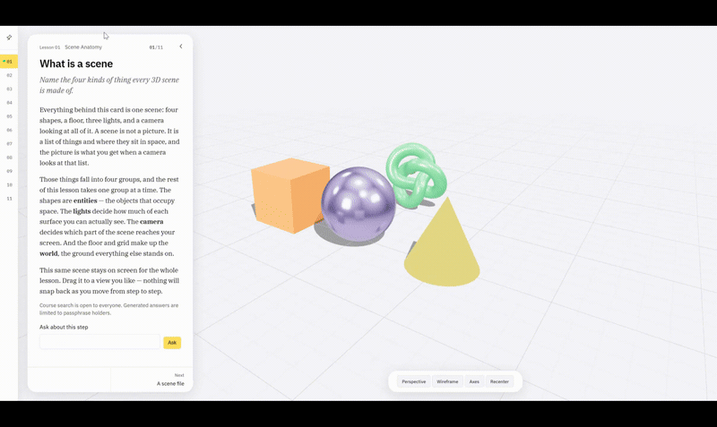
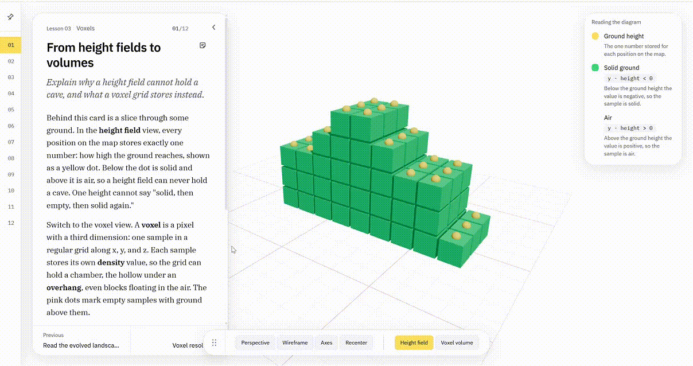
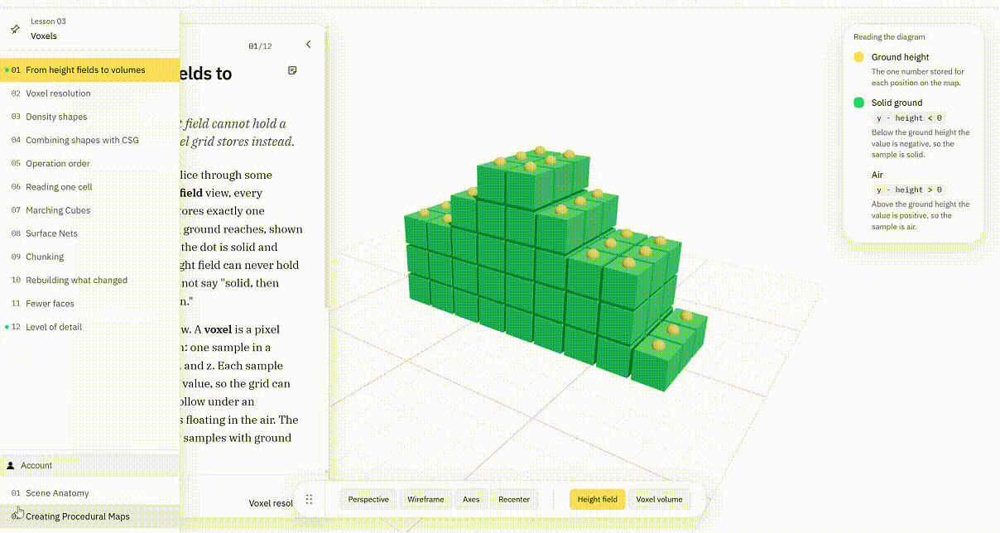
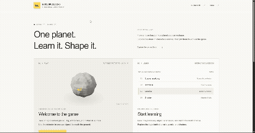
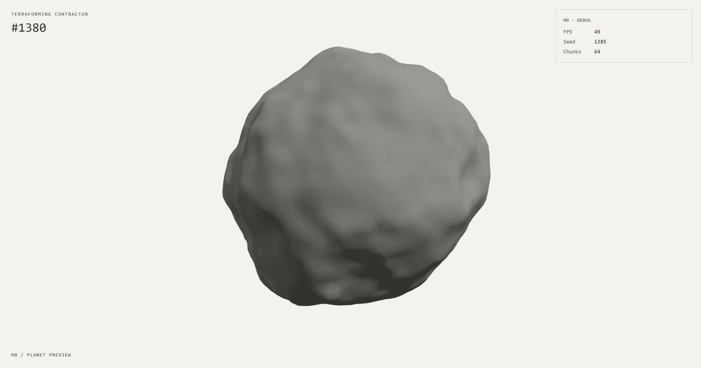
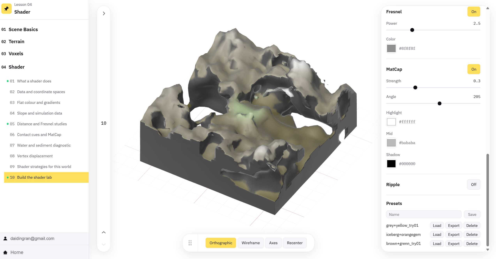

# Procedural World Building

This repository has two connected parts:

### Guidebook
Learn procedural world-building techniques through interactive lessons.

### Terraforming Contractor #1380
A procedural sandbox where players freely reshape different planets, by hand or through autonomous robots.

> “We’re here to put a dent in the universe.”

**Design direction:** planet starting conditions → player choices and robot work → environmental change → resident responses → different planetary outcomes.

Players may pursue resources, flourishing habitats, or unusual planetary forms. Residents “vote with their feet”; their movement makes consequences visible without imposing one ideal outcome.

**Current prototype:** manual terrain editing, Miner/Gardener/Builder automation, operating feedback, surface exploration, a world map, and broadcast-triggered travel are implemented. Persistent revisitable planets, responsive residents, and a live 3D system overview are planned, not implemented. See the [game design](terraforming-1380/docs/design.md) and [roadmap](terraforming-1380/docs/roadmap.md).

```text
Guidebook ─────── ★ selected techniques ───────▶ Game
     │                                              │
     └──────────── one shared website ──────────────┘
```

Coursework for DESIGN 4197/6197: Procedural World Building. The guidebook develops terrain and shader techniques that feed into the game.

## Repository structure

```text
Repository
├── worldbuilding-guidebook/   interactive lessons and 3D demos
├── terraforming-1380/         game prototype
├── docs/                      Course Documentation
│   ├── tutorials/             reference & setup
│   ├── exercise/              weekly assignment documentation
│   └── media/                 GIFs & screenshots
└── deployment/                homepage, combined build, Hosting routes
```

The two applications are independent. `deployment/` combines their builds with the project homepage for one Firebase Hosting site.

| Area | What you will find | Start here |
| --- | --- | --- |
| [Guidebook](worldbuilding-guidebook/) | Interactive lessons and their 3D demos | [Setup and commands](worldbuilding-guidebook/README.md) |
| [Terraforming Contractor #1380](terraforming-1380/) | Playable planet-editing prototype | [Controls and setup](terraforming-1380/README.md) |
| [Deployment](deployment/) | Homepage, combined build, and Hosting routes | [Build and preview](deployment/README.md) |
| [Course Documentation](docs/) | Tutorials, weekly exercise write-ups, and GIFs/screenshots | [Exercise index](docs/exercise/README.md) |

For a specific change, use this map:

| Looking for... | Location |
| --- | --- |
| Lesson text and step definitions | [`worldbuilding-guidebook/content/lessons/`](worldbuilding-guidebook/content/lessons/) |
| Guidebook scenes and shader experiments | [`worldbuilding-guidebook/src/scene/demos/`](worldbuilding-guidebook/src/scene/demos/) |
| Guidebook layout, controls, progress, and account sync | [`src/app/`](worldbuilding-guidebook/src/app/), [`src/components/`](worldbuilding-guidebook/src/components/), [`src/store/`](worldbuilding-guidebook/src/store/), [`src/firebase/`](worldbuilding-guidebook/src/firebase/) in the guidebook |
| Game planet generation and editing | [`terraforming-1380/src/world/`](terraforming-1380/src/world/) and [`src/tools/`](terraforming-1380/src/tools/) |
| Game camera, detector display, and run state | [`src/views/`](terraforming-1380/src/views/) and [`src/state/`](terraforming-1380/src/state/) in the game |
| Game design decisions and milestones | [`terraforming-1380/docs/`](terraforming-1380/docs/) |
| Homepage and Firebase routes | [`deployment/home/`](deployment/home/) and [`deployment/firebase.json`](deployment/firebase.json) |
| Course experiments and screenshots | [`docs/exercise/`](docs/exercise/) and [`docs/media/`](docs/media/) |
| Deployment automation | [`.github/workflows/`](.github/workflows/) |

Each app has its own dependencies, tests, and build. Generated folders such as `node_modules/`, `dist/`, and `deployment/public/` are build output rather than source.

## Preview the homepage locally

From the repository root (`E:\Cornell\26fall\procedural world building\dd699`):

```powershell
npm.cmd ci --prefix worldbuilding-guidebook   # first time only
npm.cmd ci --prefix terraforming-1380         # first time only
npm.cmd --prefix deployment run build         # rebuild after every change
npm.cmd --prefix deployment run preview       # starts the Firebase Hosting emulator
```

Then open <http://127.0.0.1:5002/>. The homepage is `/`, the guidebook is `/guidebook/`, and the game is `/game/`. Stop the server with `Ctrl+C`. The preview serves the built copy in `deployment/public/`, so edits to `deployment/home/` or to either app show up only after running the build again. Details are in the [deployment README](deployment/README.md#build-and-preview).

To work on just the guidebook with live reload, see [Run the website](worldbuilding-guidebook/README.md#run-the-website) (it is served at <http://localhost:5173/guidebook/>).

## Shared website deployment

The project home runs at `/`, the guidebook at `/guidebook/`, and Terraforming Contractor #1380 at `/game/`.
Each app builds independently; `deployment/` combines their outputs for the
same Firebase Hosting site. See [build, preview and deploy instructions](deployment/README.md).
Use the shared deployment command instead of the old guidebook-only deploy command.

## Log

### Week 1 — Repository initialization (August 26–30, 2026)

<details>
<summary>View weekly details</summary>

- **Progress:** Initialized the repository, established the documentation structure, and created an initial feature backlog (later replaced by the project-specific plans).
- **Key files:** `README.md`, `docs/tutorials/README.md`, `docs/exercise/README.md`
- **Keywords:** repository setup, project planning, documentation structure, feature backlog

</details>

### Week 2 — React Three Fiber fundamentals (August 31–September 6, 2026)

<details>
<summary>View weekly details</summary>



- **Progress:** Built an interactive React Three Fiber practice scene with geometry, materials, lighting, shadows, a world grid, and orbit camera controls. Added a reusable learning UI that connects DOM entity selection with the 3D scene, then documented both the prerequisite concepts and hands-on observations.
- **Key files:** `worldbuilding-guidebook/src/App.jsx`, `worldbuilding-guidebook/src/App.css`, `worldbuilding-guidebook/src/index.css`, `docs/tutorials/react-basics.md`, `docs/tutorials/threejs-react-scene.md`, `docs/exercise/01-r3f-baseline-scene.md`, `docs/exercise/02-scene-learning-ui.md`
- **Keywords:** React, JSX, CSS, Three.js, React Three Fiber, Drei, geometry, materials, lighting, shadows, camera, OrbitControls, DOM overlay, shared state, reusable UI

</details>

### Week 3 — Procedural maps: noise terrain and simulation-driven erosion (September 7–13, 2026)

<details>
<summary>View weekly details</summary>


- **Progress:** Built a function-based procedural map pipeline (grid → noise stack → 2D map → height field → 3D terrain) with White, Value, Perlin, and Cellular/Worley noise, plus adjustable frequency, octaves, persistence, and shaping controls, where the 2D map and 3D mesh read the same sampled values. Extended this into a simulation-driven map: a simplified hydraulic-erosion simulation that stores height, water, and sediment per cell, updates through double-buffered grids so every cell shares one definition of a timestep, and exposes Start/Pause/Step/Reset controls, a height-based material, and a wireframe toggle. Calibrated simulation resolution, terrain mesh resolution, world size, and height amplitude together to produce believable topography.
- **Key files:** `worldbuilding-guidebook/content/lessons/02-procedural-maps/`, `worldbuilding-guidebook/src/scene/demos/proceduralMaps/noiseMath.js`, `worldbuilding-guidebook/src/scene/demos/proceduralMaps/NoiseMapPreview.jsx`, `worldbuilding-guidebook/src/scene/demos/proceduralMaps/TerrainPreview.jsx`, `worldbuilding-guidebook/src/scene/demos/proceduralMaps/simulationMath.js`, `worldbuilding-guidebook/src/scene/demos/proceduralMaps/SimulationMapPreview.jsx`, `worldbuilding-guidebook/src/scene/demos/proceduralMaps/SimulationTerrainPreview.jsx`, `docs/exercise/03-interactive-terrain-playground.md`, `docs/exercise/04-simulation-driven-maps.md`
- **Keywords:** procedural maps, noise functions, Perlin noise, Worley/cellular noise, octave stack, height field, vertex displacement, hydraulic erosion simulation, double-buffered grid state, calibration, wireframe toggle

</details>

### Week 4 — Voxel terrain: density fields, meshing, chunking, and level of detail (September 14–20, 2026)

<details>
<summary>View weekly details</summary>





- **Progress:** Built Lesson 03, twelve steps of volumetric terrain, and recorded the results in Exercise 05. Terrain became a 3D density field with one sign rule (negative inside); shapes are combined with CSG (union, subtraction, intersection), and the order of the operations changes the result (11,994 versus 11,378 solid samples for the same three fields). Extracted the surface with Marching Cubes, whose case table is generated by the same rule the one-cell step draws, and compared it with Surface Nets: about the same number of faces, but roughly one Marching Cubes triangle in ten is a thin sliver against two to three in a hundred. Cut the volume into chunks and found that without a two-sample border a chunk cannot read the corners of its last row of cells, so 3 to 26 percent of the triangles go missing; with it, the chunks make exactly the triangles of the whole volume. Rebuilt only the chunks an edit reaches (about a quarter of the time for a dent in 4 × 4 × 4 chunks), added greedy meshing (30 to 43 percent of the faces of culled meshing), and gave chunks a camera-based level of detail, snapping the seams between levels together (largest height gap 0.36 → 0.01 world units). Web Workers, Dual Contouring and exact seam stitching are named and not built. The lesson is delivered through the course site built alongside it: content-driven steps, one shared canvas, code extracted from the real source, and practice tasks. Around the lesson: step legends, a per-step sticky note, a Grayscale view, an olive low-ground palette, rain and a water surface on the erosion terrain, a Chunk outlines toggle, and the course tutor shelved until every lesson is written. Wrote a Firebase tutorial and, on request, brought accounts forward from the roadmap's "after every lesson" plan: Authentication (email/password) and Firestore (one configuration document per user), plus Hosting, which is now the deployed production target in place of Vercel. Storage was deliberately left out — it now requires the paid Blaze plan, so the save/load feature stays Firestore-only (the latest save, no backup history) and the project stays on the free Spark plan. An Account drawer in the outline rail saves and loads a learner's scene params, view toggles, and progress. The spec's non-goal and roadmap entry for this were updated in place to record the exception, dated and reasoned, rather than left to disagree with the code.
- **Key files:** `worldbuilding-guidebook/content/lessons/03-voxels/`, `worldbuilding-guidebook/src/scene/demos/voxels/voxelMath.js`, `worldbuilding-guidebook/src/scene/demos/voxels/marchingCubes.js`, `worldbuilding-guidebook/src/scene/demos/voxels/surfaceNets.js`, `worldbuilding-guidebook/src/scene/demos/voxels/chunks.js`, `worldbuilding-guidebook/src/scene/demos/voxels/greedyMeshing.js`, `worldbuilding-guidebook/src/scene/demos/voxels/lodChunks.js`, `docs/exercise/05-voxel-terrain.md`, `docs/tutorials/firebase-setup.md`, `worldbuilding-guidebook/src/firebase/client.js`, `worldbuilding-guidebook/src/firebase/configSync.js`, `worldbuilding-guidebook/src/store/authStore.js`, `worldbuilding-guidebook/src/components/AccountDrawer.jsx`, `worldbuilding-guidebook/firestore.rules`, `worldbuilding-guidebook/firebase.json`
- **Keywords:** voxels, density field, signed distance field, CSG, Marching Cubes, Surface Nets, chunking, dirty-chunk remesh, greedy meshing, level of detail, seam snapping, Firebase, Authentication, Firestore, Hosting, cross-device configuration sync

</details>

### Week 5: Shader studies and a material lab (September 21–27, 2026)

<details>
<summary>View weekly details</summary>

<!-- Week 5 guidebook demo GIFs will be added here. -->

#### Guidebook: shaders and a material lab

Expanded Lesson 04 into ten steps with interactive comparisons, source-linked GLSL examples, legends, and practice questions. The studies cover flat colour, height gradients and snow lines, slope-based rock, distance masks, Fresnel rims, MatCap shading, standing-water diagnostics, and animated vertex displacement. A separate coordinate-space demo compares local and world-space stripes across neighboring meshes. The MatCap legend previews the texture used by the material, and shader controls use ranges chosen to produce visible changes on the demo terrain.

The water study computes trapped rainwater from Ground's height function using a flood fill, then uploads the depths as a data texture. This is a static terrain diagnostic; live erosion and sediment data are not connected yet. The same Ground water map is used when switching to Caves or Floating islands, a limitation explained in the lesson. Vertex ripples change the rendered surface without editing the underlying density field.

Added a composite shader lab where height colours can be combined with rock, snow, water, scan, Fresnel, MatCap, and ripple layers. The panel exposes layer controls and colours, terrain shape and resolution, named presets, and JSON import/export. Configurations persist locally and are included in account saves. Added an "Apply to Final Project" star on lesson steps and in the outline, simplified lesson titles, and extended Firebase sync to load on sign-in and auto-save after a two-second pause in changes, with save status in the Account drawer.

- **Key files:** [Shader lesson](worldbuilding-guidebook/content/lessons/04-shaders/), [shader demos](worldbuilding-guidebook/src/scene/demos/shaders/), [CompositeLabPanel.jsx](worldbuilding-guidebook/src/components/CompositeLabPanel.jsx), [compositeLabStore.js](worldbuilding-guidebook/src/store/compositeLabStore.js), [configSync.js](worldbuilding-guidebook/src/firebase/configSync.js), [shader study notes](docs/exercise/06-shader-studies.md)
- **Keywords:** GLSL, coordinate spaces, shader composition, MatCap, Fresnel, data textures, presets, automatic configuration sync

</details>

### Week 6: Distributions and the first game prototype (September 28–October 4, 2026)

<details>
<summary>View weekly details</summary>

#### Guidebook: Lesson 05, Distributions

Completed the eight-step distributions lesson. It begins with instanced rocks and separates candidate count, asset scale, and seeded placement so a layout can be reproduced. Noise masks turn uniform placement into patches, while a lattice and terrain maps place farmland above water and within a chosen moisture band. Later steps align assets to surface normals, filter them by slope, and combine five independent layers: rocks, trees, farmland, antennas, and a four-building base.

The final population keeps a separate seed and rule set for each layer. It places the base at the flattest suitable anchor, reserves an exclusion zone around it, applies minimum spacing to antennas, and drives tree and field variation from moisture. Candidate, rejection, height, slope, and moisture overlays make each rule inspectable. All eight steps include a live scene, source excerpt, fill practice, and automated coverage; the final guidebook test run passed 88 tests with one intentionally skipped Tutor test.

#### Game: initial editable planet, added September 30

Created `terraforming-1380/` as an independent Vite, React, and TypeScript app with design, specification, roadmap, tuning, and decision documents. The prototype uses a seeded sphere-plus-noise density field and extracts its surface with chunked Marching Cubes. Right-drag orbits the planet. Dig, Add Terrain, and Flatten edit the density field and rebuild affected chunks; Flatten supports both a local radial plane and a global horizontal plane. A remaining-volume estimate tracks terrain added or removed.



The Detector scans a local patch and shows nearby terrain wireframe plus distance-faded Mineral, Life, and Memory signals. Each signal has its own marker shape. Exposing a target's centre collects it, animates the transfer to the HUD, and updates the category count. At this point, deposits are seeded proxies; resource economics, tool costs, surface movement, and endings were still planned.





#### Shared site and repository maintenance

Added the combined Firebase Hosting build. The homepage is served at `/`, the guidebook at `/guidebook/`, and the game at `/game/`, with deep-link rewrites and redirects for old lesson URLs. The deployment workflows install both apps, run the game tests, build the combined site, and verify its routes and assets.

- **Key files:** [Lesson 05](worldbuilding-guidebook/content/lessons/05-distributions/), [distribution demos](worldbuilding-guidebook/src/scene/demos/distributions/), [Exercise 07](docs/exercise/07-scattering-system.md), [game source](terraforming-1380/src/), [game design](terraforming-1380/docs/design.md), [game tests](terraforming-1380/tests/planet.test.ts), [deployment build](deployment/build.mjs)
- **Keywords:** instancing, deterministic seeds, noise masks, terrain maps, surface normals, slope filtering, layered populations, seeded planet, Marching Cubes, terrain editing, detector, Firebase Hosting

</details>

### Week 7: Paths, particles, and game terrain LOD (October 5–11, 2026)

<details>
<summary>View weekly details</summary>

#### Guidebook: Lesson 06, Paths

Completed six pathfinding and spline scenes around one resident travelling from a cave entrance to shelter. The lesson moves from ordered waypoints to a centripetal Catmull-Rom curve, then compares parameter-based movement with distance-based movement. It projects samples onto a height field, checks body clearance and ground support across each segment, and revalidates the route after a local terrain edit.

The final scene generates bounded route candidates for two shelters, rejects blocked, unsupported, or overly steep paths before ranking the valid ones by normalized distance and disturbance, and leaves the resident waiting when both routes fail. These are guidebook teaching scenes. They do not add resident migration or a cave solver to the game.

#### Guidebook: Lesson 07, Particles

Completed eight particle-system scenes using one typed-array state model. The lesson covers emission, lifetime, capacity, frame-rate-independent movement, forces, velocity and acceleration fields, and additive breeze, vortex, and gust layers. Later steps compare dots, puffs, and trails, show the stray-line bug caused by retaining trail history after recycling, and map speed and age to colour and opacity.

The final recipe scene includes Dust, Mist, Rain, and Spores presets. Each preset controls its emitter, rate, lifetime, representation, wind, gravity, fade, ground rule, and boundary rule. Tests keep live counts within capacity, verify that the default ground rule removes particles below the terrain, and check that motion stays consistent across different frame intervals. The particle effects remain guidebook demonstrations rather than game effects.

#### Game: distance-based terrain LOD, added October 7

Added three terrain detail levels while keeping the full `64³` density grid as the editable source of truth. Nearby chunk columns use full sampling; distant columns use half or quarter sampling. Fine boundary vertices and normals snap to the neighboring coarse surface to reduce mixed-detail cracks. Mesh preparation is spread across frames, all meshes for a change switch together, terrain edits invalidate cached levels, and the debug overlay reports the visible chunk count at each level.

The same day's site update refreshed the project homepage, navigation, and favicons without coupling the two applications. The game and guidebook still build independently before the deployment project combines them.

- **Key files:** [Lesson 06](worldbuilding-guidebook/content/lessons/06-paths/), [path demos](worldbuilding-guidebook/src/scene/demos/paths/), [Exercise 08](docs/exercise/08-spline-layer.md), [Lesson 07](worldbuilding-guidebook/content/lessons/07-particles/), [particle demos](worldbuilding-guidebook/src/scene/demos/particles/), [Exercise 09](docs/exercise/09-particle-system.md), [game LOD](terraforming-1380/src/world/lodChunks.js), [planet generation](terraforming-1380/src/world/planet.ts)
- **Keywords:** waypoints, Catmull-Rom splines, arc-length movement, terrain projection, clearance, route validation, particle lifecycle, vector fields, trails, atmospheric presets, chunk LOD, seam snapping

</details>
