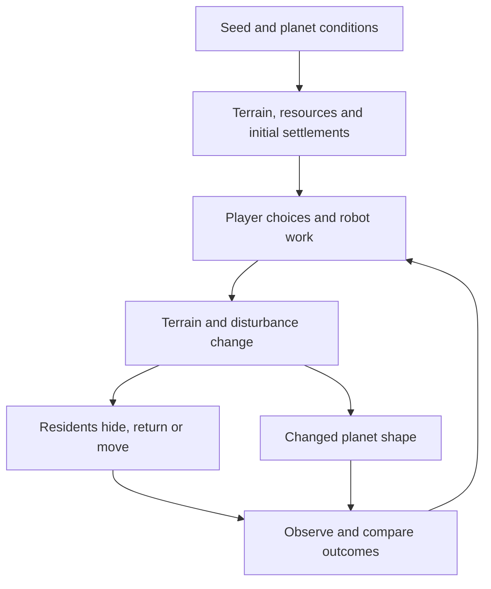

# Procedural system — planets, work and residents

**Status:** design target (D-034–037), not an implementation report.  
**Updated:** 2026-10-20

This document explains the causal relationships. Exact requirements and acceptance checks live in [spec.md](spec.md); numbers live in [tuning.md](tuning.md). The [crit response](reviews/2026-10-20-crit.md) records why this direction changed.

## 1. One shared chain

**Planet starting conditions → player choices and robot work → environmental change → resident responses → different planetary outcomes.**

A resident response follows conditions, not a predefined scene. Seeing the result can change the player's next choice. No universal best planet or compulsory resident-happiness score is required.

## 2. Starting conditions: constrained randomness

A stable planet ID and seed identify the initial world. Size, terrain variation, resource abundance and resource clustering are distinct parameters; a small world can be rich and a large world sparse. The seed does not substitute for storing subsequent edits.

Initial residents are placed at valid, reachable habitat candidates rather than uniformly in empty space or solid rock. Individual scale, proportions and texture may vary within a species' visual rules. The same seed and generation version should reproduce the same initial conditions; runtime responses follow current conditions and commands.

**First slice:** one planet, one species, a few visible settlements. Exact counts and final body shape remain open. The six rock sketches are exploration, not six approved species.

## 3. Work and consequences

| Actor | Reads | Changes | Visible consequence |
| --- | --- | --- | --- |
| Player: Dig | Current density and brush | Removes terrain; planned local disturbance | Cavity appears, shelter may be created or lost |
| Player: Add / Flatten | Current density and brush plane | Adds or reshapes terrain; planned disturbance | Entrance may be blocked, cover or routes may change |
| Miner | Local scan, eligible minerals, current density | Excavates and collects; planned disturbance | Repeated tunnels and local resident reactions |
| Builder | Ground levels, soil stock, protected structures | Cuts and fills | Shelter and passage geometry changes |
| Gardener | Suitable ground, spacing and prepared sites | Plants grow and spread | Vegetation changes; first cave species need not prefer it |
| Signal facility | Antennas and explicit player broadcast | Discovery state | New planet entries; not an automatic reward for gardening |

**Current coupling:** the Gardener also builds antennas. Separating those roles is proposed in D-038, not approved or implemented. Do not silently reinterpret the existing behavior.

Manual edits and robot edits must eventually feed the same habitat/disturbance rules. Flatness, plant count and resident suitability are different things.

## 4. Environmental conditions

Use actual edited terrain to validate shelter, entrances and possible routes. A sufficiently enclosed cavity with room for the resident can be suitable; a huge open pit is not automatically a home.

Working tools/robots generate temporary local disturbance. It fades when work stops. Initial implementation can use a bounded distance-based vibration signal, not acoustic propagation or a structural physics simulation.

Recheck affected habitat after edits. A blocked entrance or removed support makes a home invalid regardless of a previously high suitability score. Valid routes are a hard constraint: residents must not teleport through intact rock.

## 5. First species: quiet cave dwellers

**Approved direction:** small rock-like residents, inspired by the broad charm of rock Pikmin but with an original body design. Gray/off-white, low saturation, coarse tactile surfaces.

| Preference | Observable behavior |
| --- | --- |
| A snug cavity with cover | Sits inside and peeks out; does not simply seek maximum open volume |
| Low vibration | Brief work prompts retreat; prolonged disruption may cause relocation |
| Nearby companions | Small clusters of separate homes rather than everyone occupying one point |
| Familiar home | Waits through brief disruption instead of immediately moving |
| Sheltered paths | Moves near rock boundaries where feasible |

The first implementation uses three main preferences: **cave fit, low disturbance, nearby companions**. Wall following and social gestures can be simplified until the basic response works.

### Behavior sequence

Calm/peeking → disturbed/retreating → sheltered waiting → either return after quiet, or search and move after sustained disturbance / habitat loss → inspect and occupy a valid new home.

These are behavior intentions; exact state names and durations are provisional. Add hysteresis/cooldowns so residents do not oscillate between two homes. Reachable shelter and clearance take priority over social attraction.

If no valid home exists, keep a visible bounded searching/waiting response. Do not erase residents, invent off-screen migration, kill them, or end the run by default. Those outcomes would require a separate decision.

**Optional visual detail:** a pebble used as a door. No stone-hauling simulation is required by the first slice.

### Worked example

1. A group occupies snug cavities beside an ore deposit.
2. A Miner begins work nearby; residents retreat from their entrances.
3. Brief work followed by quiet lets them peek out again.
4. Sustained disturbance can make them seek a reachable quieter cavity.
5. After work stops, a new tunnel may become a valid home if enclosure, clearance and access suit them.
6. A broad exposed pit may remain empty even after all vibration fades.

This demonstrates rule-driven consequences without deciding that all mining harms or helps residents.

## 6. Multiple planets and the system view

**Current prototype:** D-032 reveals screen-positioned distant planet entries after broadcasts. Travel resets the site, keeping funds only. Entry icon size does not establish a different playable planet radius.

**Target:**
- Preserve per-planet seed/config, edited density or replayable terrain history, resources, robots, structures, residents and local signals.
- Keep stable discovered IDs and a selected planet ID. Returning retrieves the same site.
- Render a 3D overview with real spatial positions and simplified meshes derived from each planet's latest terrain. Decorative spheres are insufficient as development results.
- Hover shows a few descriptive values; click visits a planet. “Progress” describes change, not completion toward one ideal outcome.
- Propagate terrain revisions to the overview while simulation is running. The same planet record supplies both views.

Same-session persistence across travel is required. Saving across browser reloads, inactive-world simulation, update cadence and whether funds are global or local remain open. Do not promise all planets run continuously before choosing a performance budget.

## 7. Readability and scope

Money can be computed internally. A compact status and actionable critical messages should explain any operating restriction; no line-by-line spending dashboard is required. Current debt/bankruptcy behavior remains until explicitly revised.

First prove one species and one causal relationship. Then preserve two planets across travel; then show edited shapes together. Expand species and planet variation after that works.

## 8. Links to course techniques

| Technique | Role in the project |
| --- | --- |
| Seeded distributions | Terrain/resources, valid initial settlements and bounded visual variation |
| Density fields / CSG / Marching Cubes | Actual excavated geometry and shelter validation |
| Paths | Reachable migration and obstacle-aware motion |
| Vector fields / steering | Optional local attraction/avoidance; never a substitute for terrain clearance |
| Particles / shaders | Disturbance, debris and visual emphasis, separate from behavior rules |

**Open:** resident silhouette, cave detection strategy, tuning values, antenna-role separation, background simulation and reload persistence.
