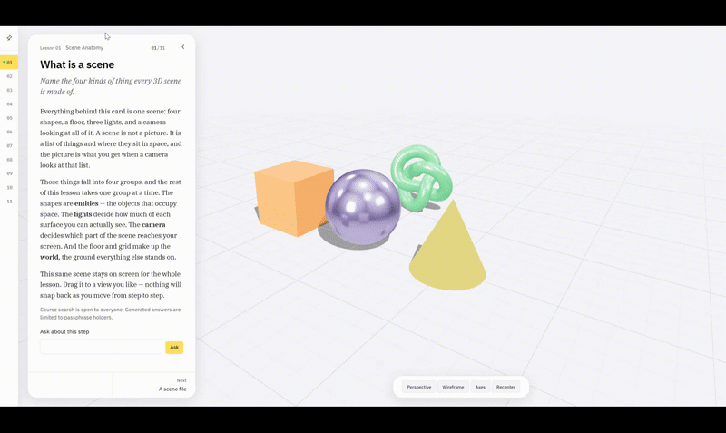
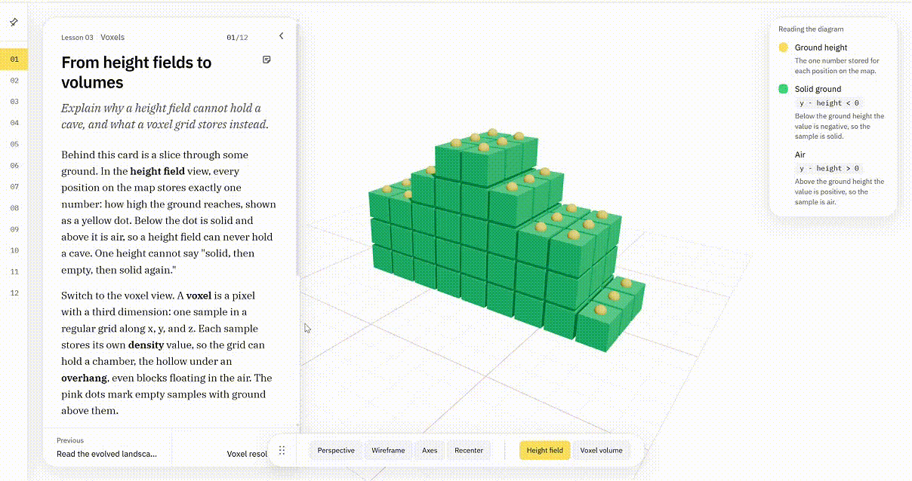
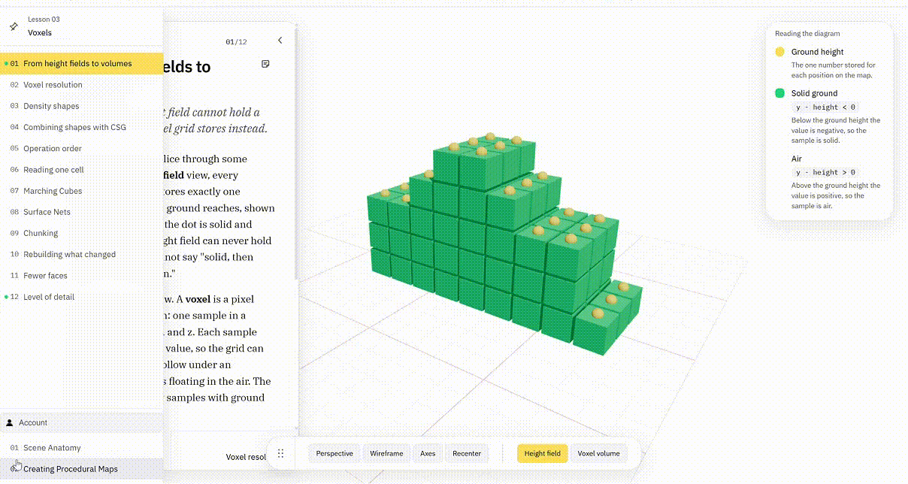
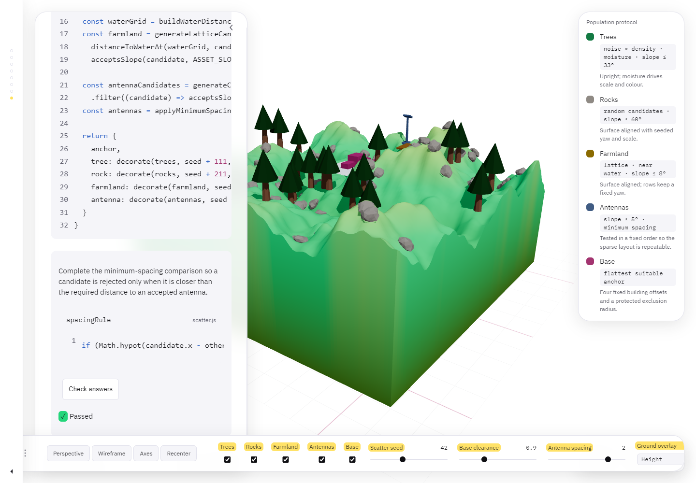
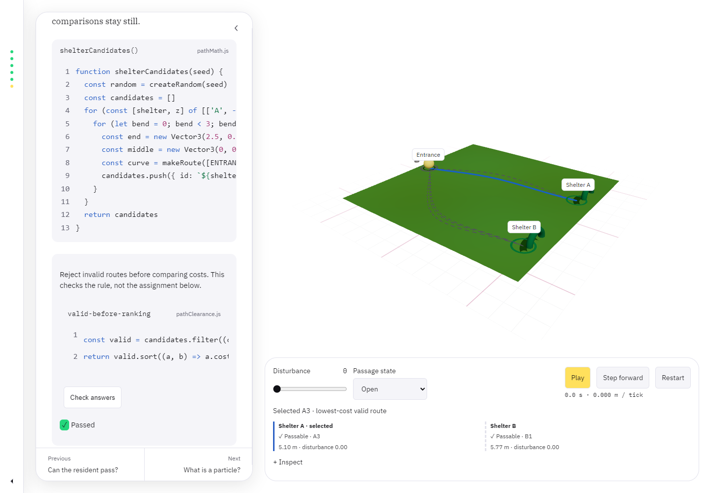
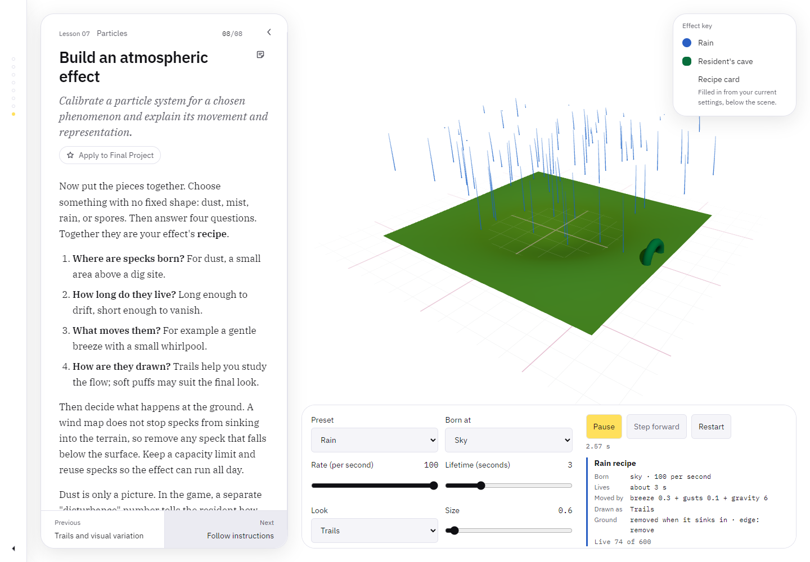
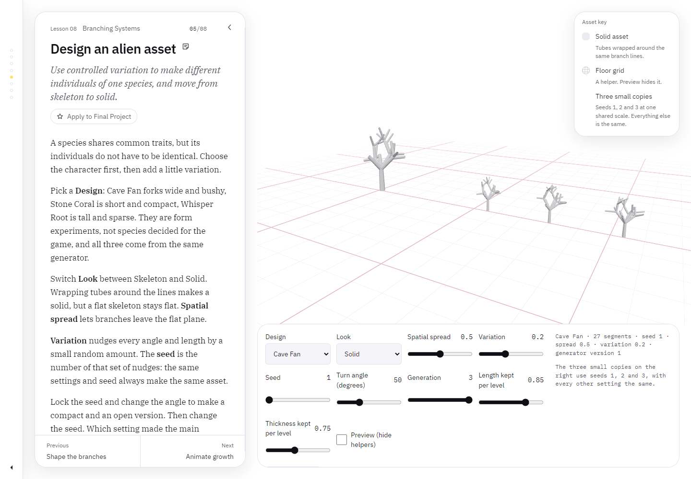
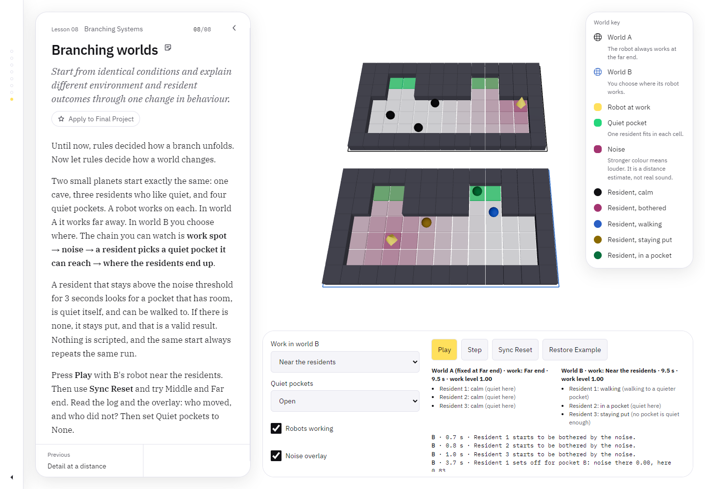

# Guidebook weekly log

The guidebook is the course-learning half of the project: interactive lessons on procedural techniques, each built around live 3D demos. The final project, [Terraforming Contractor #1380](../README.md), borrows techniques from it. For setup, commands and the lesson workflow, see the [guidebook README](README.md).

| Week | Lesson / work | Notes |
| --- | --- | --- |
| 2 | React Three Fiber fundamentals | [Exercise 01](../docs/exercise/01-r3f-baseline-scene.md), [Exercise 02](../docs/exercise/02-scene-learning-ui.md) |
| 3 | [Lesson 02, Procedural maps](content/lessons/02-procedural-maps/) | [Exercise 03](../docs/exercise/03-interactive-terrain-playground.md), [Exercise 04](../docs/exercise/04-simulation-driven-maps.md) |
| 4 | [Lesson 03, Voxels](content/lessons/03-voxels/) | [Exercise 05](../docs/exercise/05-voxel-terrain.md) |
| 5 | [Lesson 04, Shaders](content/lessons/04-shaders/) | [Exercise 06](../docs/exercise/06-shader-studies.md) |
| 6 | [Lesson 05, Distributions](content/lessons/05-distributions/) | [Exercise 07](../docs/exercise/07-scattering-system.md) |
| 7 | [Lesson 06, Paths](content/lessons/06-paths/) and [Lesson 07, Particles](content/lessons/07-particles/) | [Exercise 08](../docs/exercise/08-spline-layer.md), [Exercise 09](../docs/exercise/09-particle-system.md) |
| 8 | [Lesson 08, Branching systems](content/lessons/08-branching-systems/) | [Exercise 10](../docs/exercise/10-branching-systems.md) |

## Week 2: React Three Fiber fundamentals (August 31–September 6, 2026)

- **Progress:** Built an interactive React Three Fiber practice scene with geometry, materials, lighting, shadows, a world grid, and orbit camera controls. Added a reusable learning UI that connects DOM entity selection with the 3D scene, then documented both the prerequisite concepts and hands-on observations.
- **Keywords:** React, Three.js, React Three Fiber, Drei, geometry, materials, lighting, shadows, camera, OrbitControls, DOM overlay, shared state

## Week 3: Procedural maps, noise terrain and simulation-driven erosion (September 7–13, 2026)

- **Progress:** Built a function-based procedural map pipeline (grid → noise stack → 2D map → height field → 3D terrain) with White, Value, Perlin, and Cellular/Worley noise, plus adjustable frequency, octaves, persistence, and shaping controls, where the 2D map and 3D mesh read the same sampled values. Extended this into a simulation-driven map: a simplified hydraulic-erosion simulation that stores height, water, and sediment per cell, updates through double-buffered grids so every cell shares one definition of a timestep, and exposes Start/Pause/Step/Reset controls, a height-based material, and a wireframe toggle. Calibrated simulation resolution, terrain mesh resolution, world size, and height amplitude together to produce believable topography.
- **Key files:** [Lesson 02](content/lessons/02-procedural-maps/), [noise and simulation demos](src/scene/demos/proceduralMaps/), [Exercise 03](../docs/exercise/03-interactive-terrain-playground.md), [Exercise 04](../docs/exercise/04-simulation-driven-maps.md)
- **Keywords:** noise functions, Perlin noise, Worley noise, octave stack, height field, vertex displacement, hydraulic erosion, double-buffered grid state, calibration

## Week 4: Voxel terrain, with density fields, meshing, chunking and level of detail (September 14–20, 2026)

- **Progress:** Built Lesson 03, twelve steps of volumetric terrain, and recorded the results in Exercise 05. Terrain became a 3D density field with one sign rule (negative inside); shapes are combined with CSG (union, subtraction, intersection), and the order of the operations changes the result (11,994 versus 11,378 solid samples for the same three fields). Extracted the surface with Marching Cubes, whose case table is generated by the same rule the one-cell step draws, and compared it with Surface Nets: about the same number of faces, but roughly one Marching Cubes triangle in ten is a thin sliver against two to three in a hundred. Cut the volume into chunks and found that without a two-sample border a chunk cannot read the corners of its last row of cells, so 3 to 26 percent of the triangles go missing; with it, the chunks make exactly the triangles of the whole volume. Rebuilt only the chunks an edit reaches (about a quarter of the time for a dent in 4 × 4 × 4 chunks), added greedy meshing (30 to 43 percent of the faces of culled meshing), and gave chunks a camera-based level of detail, snapping the seams between levels together (largest height gap 0.36 → 0.01 world units). Web Workers, Dual Contouring and exact seam stitching are named and not built.
- **Site work:** The lesson is delivered through the course site built alongside it: content-driven steps, one shared canvas, code extracted from the real source, practice tasks, step legends, a per-step sticky note, and a Grayscale view. Wrote a [Firebase tutorial](../docs/tutorials/firebase-setup.md) and added accounts: Authentication (email/password) and Firestore (one configuration document per user), plus Hosting as the production target. Storage was left out because it requires the paid Blaze plan, so save/load stays Firestore-only (the latest save, no backup history) and the project stays on the free Spark plan. The course tutor is shelved until every lesson is written.
- **Key files:** [Lesson 03](content/lessons/03-voxels/), [voxel demos](src/scene/demos/voxels/), [Exercise 05](../docs/exercise/05-voxel-terrain.md), [Firebase client](src/firebase/client.js), [configuration sync](src/firebase/configSync.js), [Account drawer](src/components/AccountDrawer.jsx)
- **Keywords:** density field, signed distance field, CSG, Marching Cubes, Surface Nets, chunking, dirty-chunk remesh, greedy meshing, level of detail, seam snapping, Firebase

## Week 5: Shader studies and a material lab (September 21–27, 2026)

Expanded Lesson 04 into ten steps with interactive comparisons, source-linked GLSL examples, legends, and practice questions. The studies cover flat colour, height gradients and snow lines, slope-based rock, distance masks, Fresnel rims, MatCap shading, standing-water diagnostics, and animated vertex displacement. A separate coordinate-space demo compares local and world-space stripes across neighboring meshes. The MatCap legend previews the texture used by the material, and shader controls use ranges chosen to produce visible changes on the demo terrain.

The water study computes trapped rainwater from Ground's height function using a flood fill, then uploads the depths as a data texture. This is a static terrain diagnostic; live erosion and sediment data are not connected. Vertex ripples change the rendered surface without editing the underlying density field.

Added a composite shader lab where height colours can be combined with rock, snow, water, scan, Fresnel, MatCap, and ripple layers. The panel exposes layer controls and colours, terrain shape and resolution, named presets, and JSON import/export. Configurations persist locally and are included in account saves, which load on sign-in and auto-save after a two-second pause in changes. Lesson steps and the outline gained an "Apply to Final Project" star.

- **Key files:** [Shader lesson](content/lessons/04-shaders/), [shader demos](src/scene/demos/shaders/), [CompositeLabPanel.jsx](src/components/CompositeLabPanel.jsx), [compositeLabStore.js](src/store/compositeLabStore.js), [shader study notes](../docs/exercise/06-shader-studies.md)
- **Keywords:** GLSL, coordinate spaces, shader composition, MatCap, Fresnel, data textures, presets

## Week 6: Distributions (September 28–October 4, 2026)

Completed the eight-step distributions lesson. It begins with instanced rocks and separates candidate count, asset scale, and seeded placement so a layout can be reproduced. Noise masks turn uniform placement into patches, while a lattice and terrain maps place farmland above water and within a chosen moisture band. Later steps align assets to surface normals, filter them by slope, and combine five independent layers: rocks, trees, farmland, antennas, and a four-building base.

The final population keeps a separate seed and rule set for each layer. It places the base at the flattest suitable anchor, reserves an exclusion zone around it, applies minimum spacing to antennas, and drives tree and field variation from moisture. Candidate, rejection, height, slope, and moisture overlays make each rule inspectable. All eight steps include a live scene, source excerpt, fill practice, and automated coverage; the final test run passed 88 tests with one intentionally skipped Tutor test.

- **Key files:** [Lesson 05](content/lessons/05-distributions/), [distribution demos](src/scene/demos/distributions/), [Exercise 07](../docs/exercise/07-scattering-system.md)
- **Keywords:** instancing, deterministic seeds, noise masks, terrain maps, surface normals, slope filtering, layered populations

## Week 7: Paths and particles (October 5–11, 2026)

### Lesson 06, Paths

Completed six pathfinding and spline scenes around one resident travelling from a cave entrance to shelter. The lesson moves from ordered waypoints to a centripetal Catmull-Rom curve, then compares parameter-based movement with distance-based movement. It projects samples onto a height field, checks body clearance and ground support across each segment, and revalidates the route after a local terrain edit.

The final scene generates bounded route candidates for two shelters, rejects blocked, unsupported, or overly steep paths before ranking the valid ones by normalized distance and disturbance, and leaves the resident waiting when both routes fail. These are teaching scenes; they do not add a cave solver to the game.

### Lesson 07, Particles

Completed eight particle-system scenes using one typed-array state model. The lesson covers emission, lifetime, capacity, frame-rate-independent movement, forces, velocity and acceleration fields, and additive breeze, vortex, and gust layers. Later steps compare dots, puffs, and trails, show the stray-line bug caused by retaining trail history after recycling, and map speed and age to colour and opacity.

The final recipe scene includes Dust, Mist, Rain, and Spores presets. Each preset controls its emitter, rate, lifetime, representation, wind, gravity, fade, ground rule, and boundary rule. Tests keep live counts within capacity, verify that the default ground rule removes particles below the terrain, and check that motion stays consistent across different frame intervals.

- **Key files:** [Lesson 06](content/lessons/06-paths/), [path demos](src/scene/demos/paths/), [Exercise 08](../docs/exercise/08-spline-layer.md), [Lesson 07](content/lessons/07-particles/), [particle demos](src/scene/demos/particles/), [Exercise 09](../docs/exercise/09-particle-system.md)
- **Keywords:** waypoints, Catmull-Rom splines, arc-length movement, terrain projection, route validation, particle lifecycle, vector fields, trails, atmospheric presets

## Week 8: Branching systems (October 12–21, 2026)

Built an eight-step lesson that starts with turtle drawing instructions and parallel string rewriting, then adds bracket stacks, branch depth, seeded variation, solid geometry, growth animation, and three levels of detail. The asset lab uses one generator to produce Cave Fan, Stone Coral, and Whisper Root forms while keeping each seed reproducible.

The final experiment starts two small worlds from identical conditions and changes only where one robot works. Residents respond to a distance-based disturbance field, wait through short disruptions, and move along walkable routes when a quieter pocket is available. The side-by-side view and event log make the different outcomes traceable to that single change.

- **Key files:** [Lesson 08](content/lessons/08-branching-systems/), [branching demos](src/scene/demos/branching/), [Exercise 10](../docs/exercise/10-branching-systems.md), [browser tests](tests/lesson08.spec.js)
- **Keywords:** L-systems, turtle graphics, parallel rewriting, bracket stacks, seeded variation, procedural assets, growth animation, asset LOD, resident response
